# Architecture

This file explains intent. The code carries no comments (see `docs/ENGINEERING.md`); when you need to know why something is the way it is, it should be here or in a test name.

## Goals this architecture serves

1. **The app is the single source of truth for the trip.** Google Calendar, Gmail and AI assistants feed it or copy it. They never hold the master copy.
2. **Anyone can put details in, nothing goes in unreviewed.** People type into quick add. Calendars, files and AI assistants (Claude, ChatGPT) send proposals to a review inbox. A person approves.
3. **Each person sees only what they may see, everywhere.** One function decides visibility, and every screen, API, feed, calendar mirror and assistant goes through it.
4. **Times are honest.** Every instant is stored in UTC with the zone of the place it happens. Display is always local to that place.
5. **Every rule is testable without a browser, a network or a database server.**

## System context

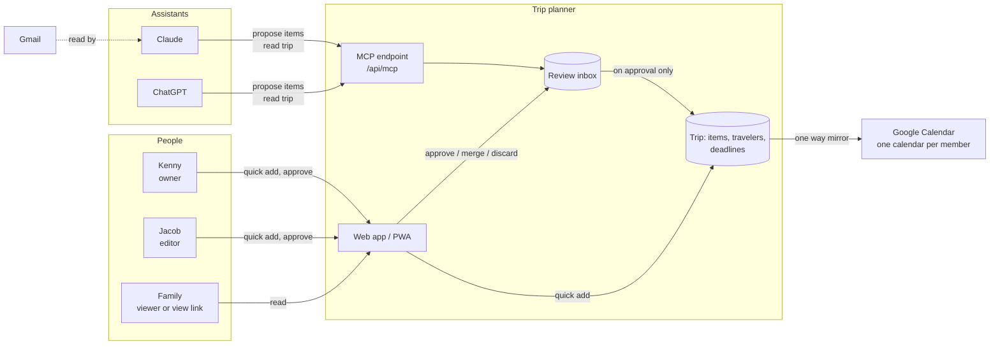

What changed from how the trip was planned before: Jacob's Claude used to read Gmail and write Google Calendar events directly. Now it writes to the app through MCP. Those proposals wait in the inbox, and Google Calendar becomes a read only copy that the app keeps up to date.

## Layers

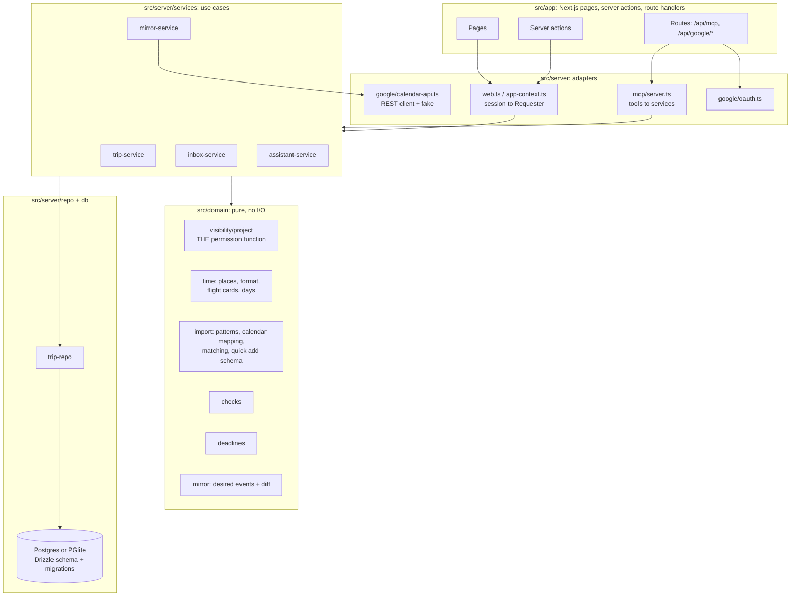

Dependency rule: arrows point inward. `src/domain` imports nothing from `src/server` or `src/app`, and does no I/O. Services get everything external (database, clock, id generator, Google client, the change hook) through `ServiceContext`, so tests pass a fresh embedded database, a fixed clock and a fake Google.

| Layer | Tested with | Why it is shaped this way |
|---|---|---|
| Domain | Plain unit tests against the fixture trip | The hard rules (time zones, visibility, matching) must be correct before any UI sits on them |
| Services | Integration tests on in-memory PGlite (real Postgres SQL) | Transactions, constraints and races are real; no database server needed |
| MCP | The official MCP client over an in-memory transport | Proves the assistant experience, not just the functions |
| Routes and pages | Running the app and calling `/api/mcp` over HTTP | Thin glue only |

## The permission boundary

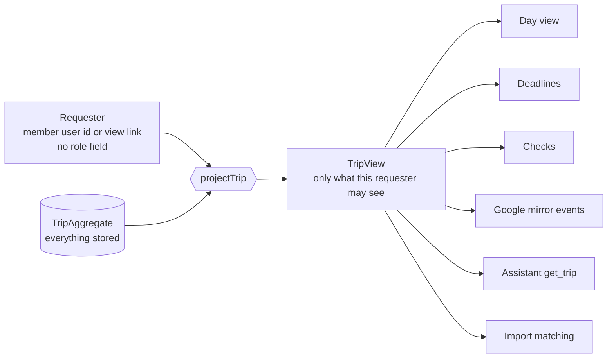

- Roles are always read from the stored membership. The requester never carries a role, so a caller cannot claim one.
- Hidden items are absent from the view, not flagged. Items shown as busy become `BusyBlock`s with a start and an end and nothing else: no id, no title.
- Sensitive fields are absent unless the role is owner or editor. The Google mirror also leaves them out by default, because a Google calendar can be shared beyond the app's control.
- Checks, deadlines, the mirror, assistant reads and import matching all take a `TripView`, so they cannot see more than the person they act for.

## Getting data in: one pipeline, many sources

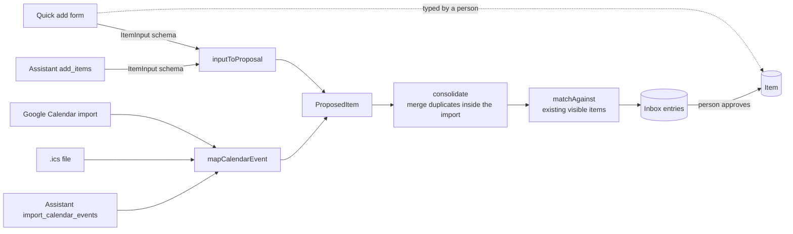

- A person typing into quick add is trusted and goes straight in. Everything else goes to the inbox.
- Zones come from airports and cities, never from the source's claimed zone. Gmail events often carry the calendar owner's zone; the fixture's CX509 claims New York.
- When a zone cannot be known, the proposal carries a `problem`, is marked needs review, and is never added in bulk.
- Two kinds of disagreement are kept apart:
  - `differences`: records inside one import disagree (CX509 at 8:50am vs 9:00am). A person must pick before adding.
  - `match.differences`: the import disagrees with an item already on the trip. A person must pick per field to merge.
- Per traveler fields (seat, confirmation code) never conflict. They become one private row per traveler, which is the NH159 case.

## State charts

### Inbox entry

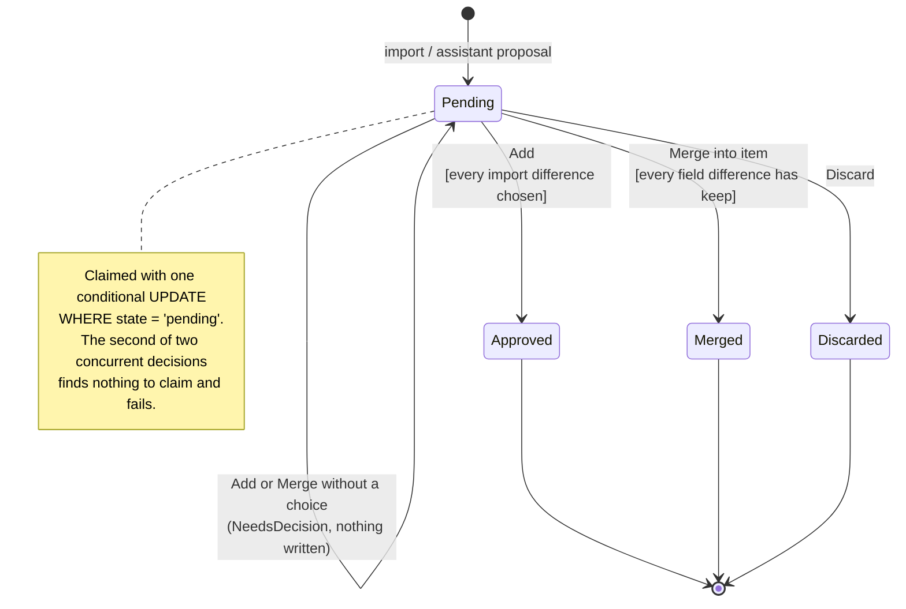

"Add all without conflicts" applies Add only to entries with no match, no differences and no problems.

### Item (as seen by one member)

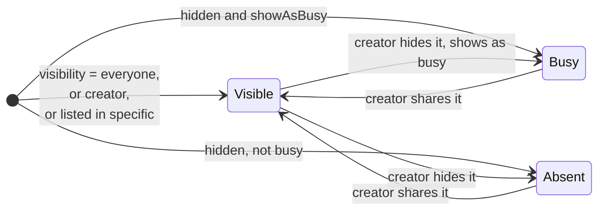

Only the creator can move an item between these states. That includes the owner, who cannot see or edit an item someone else hid from them.

### Google Calendar mirror (per member, per trip)

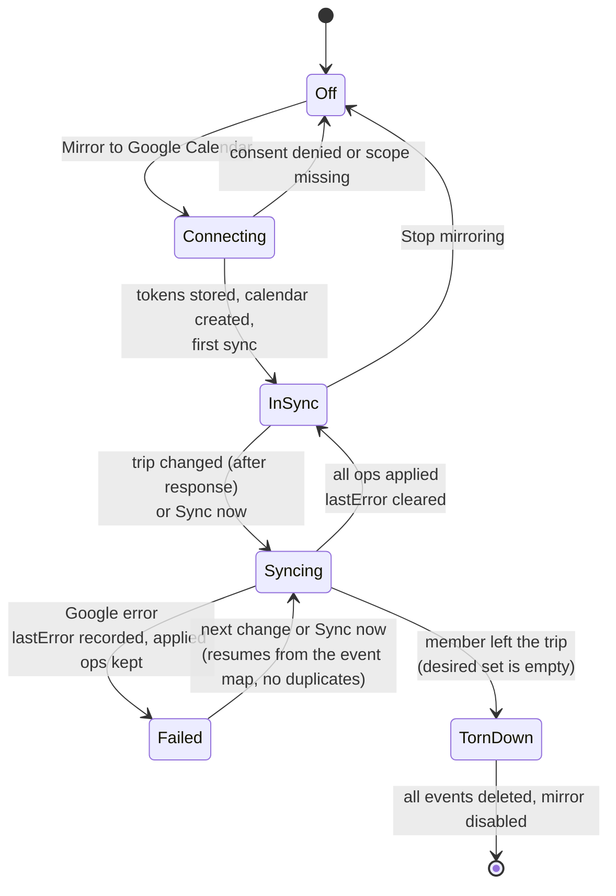

Sync is a diff. `buildMirrorEvents(view)` gives the events the calendar should hold, and `planMirrorSync` compares them with `mirror_events`, the event map of what was last pushed and its hash. The result is the minimal set of creates, updates and deletes. If someone deletes an event in Google, it is recreated on the next change: Google is a copy, the app is the source.

### Assistant connection

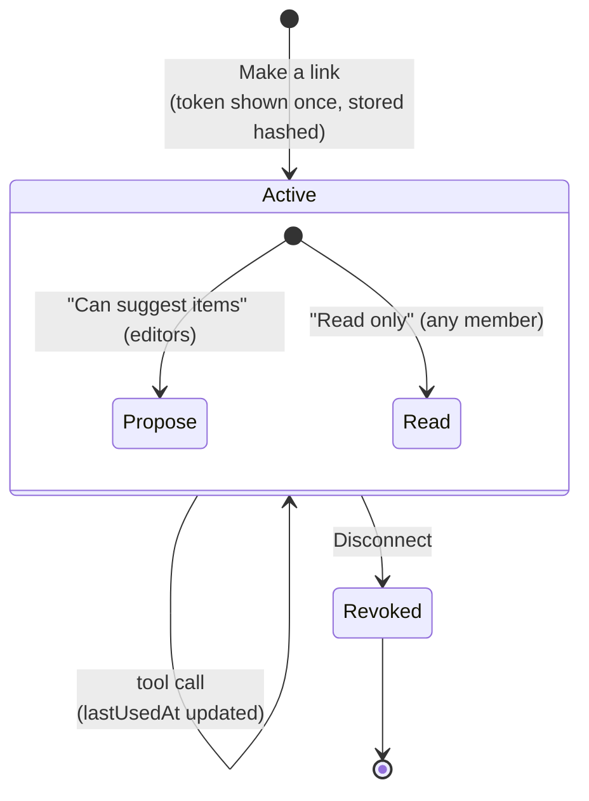

## Sequences

### Jacob's Claude adds a booking from Gmail

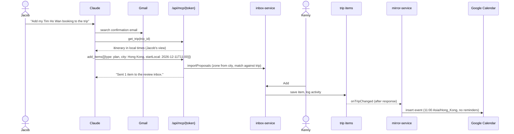

### Connecting Google Calendar

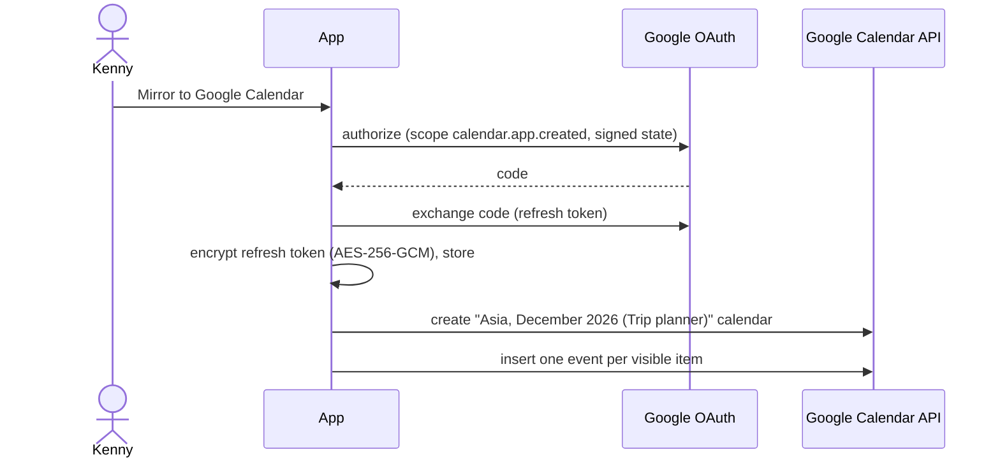

The scope `calendar.app.created` lets the app manage only calendars it created. It cannot read or change anything else in the person's Google Calendar.

## Data model (stored)

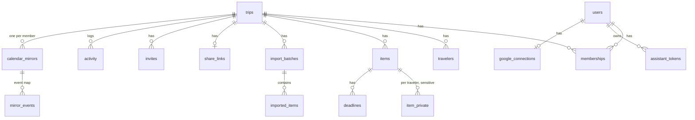

## Decisions

| Decision | Why | Revisit when |
|---|---|---|
| AI assistants connect over MCP, and the app makes no LLM calls | Keeps the v1 rule "no AI features" inside the app: the assistant is a client, like a calendar import. People use the Claude or ChatGPT they already have | An AI layer inside the app is planned (PHASES.md, Later) |
| Assistant writes always go to the review inbox | "Imports never overwrite silently". Also protects against an assistant misreading an email | Never, for writes. Reads are fine |
| Assistant auth is a secret link (token in the URL), also accepted as a Bearer header | Claude and ChatGPT custom connectors accept a URL with no auth or with OAuth; a secret URL works in both today. Tokens are hashed, scoped to a trip, read or propose, and revocable | Add OAuth 2.1 to the MCP endpoint so connectors can sign in without a secret link |
| Google mirror is one way, app to Google, one calendar per member | One source of truth. Per member, because visibility differs per member | Two way sync is not planned: edits belong in the app |
| Mirror scope `calendar.app.created` | Least privilege: no access to the person's other calendars | n/a |
| Mirrored events have no reminders and do not include codes or seats by default | v1 has no notifications; a Google calendar can be shared beyond the app's permissions | Per member setting `includeSensitive` exists and is off |
| PGlite for dev and tests, Postgres in production | Same SQL and migrations; nobody installs a database to run tests | Never for prod: PGlite is single process |
| Signed cookie session with a dev sign in | Lets the app run and be tested now | Replace with Auth.js (Google, Apple, email link) per CLAUDE.md before anyone but the builders uses it |

## Open questions (need an answer from the trip owner)

1. **"Where you are" order.** TIME_RULES says most recent arrival beats a covering stay. On Dec 6 to 10 there is no transport to Shenzhen, so that rule would say "Hong Kong" while sleeping in Shenzhen. The code uses whichever is newer, the arrival or the stay's check in. Confirm.
2. **The Gmail "Queen beds" stay.** The fixture says it should merge into the Airbnb, but IMPORT.md's matching rules (similar name or address) do not match it. It is shown as a possible match for a person to merge. Confirm that is the intended behavior.
3. **The $1,183.22 stay also overlaps the second Resol Ueno booking on Dec 13.** The fixture's expected checks do not list that overlap, but it is true, so the app reports it.
4. **Whose seat is it?** When a shared calendar record has a seat but several travelers, the seat goes to the one traveler on that record who has no seat yet. Otherwise it stays unassigned. That is how NH159 resolves to 30K Kenny, 30C Jacob.
