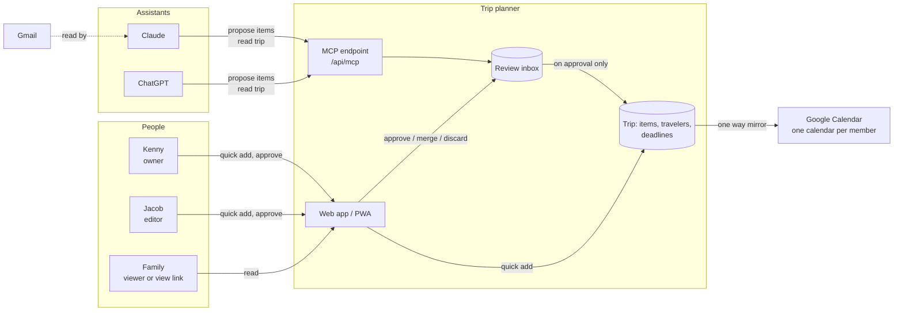
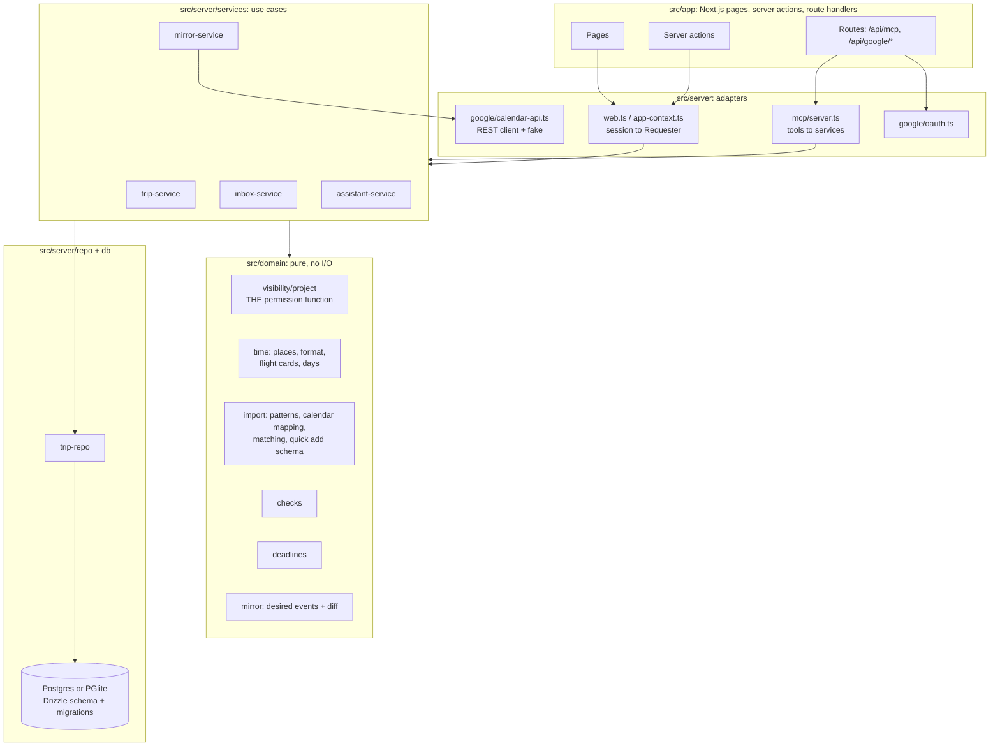
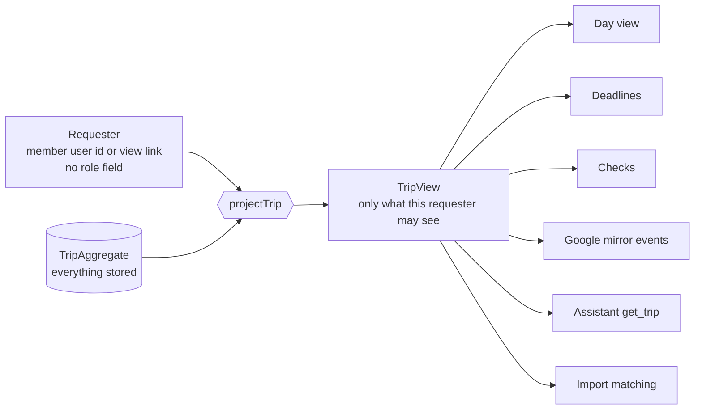
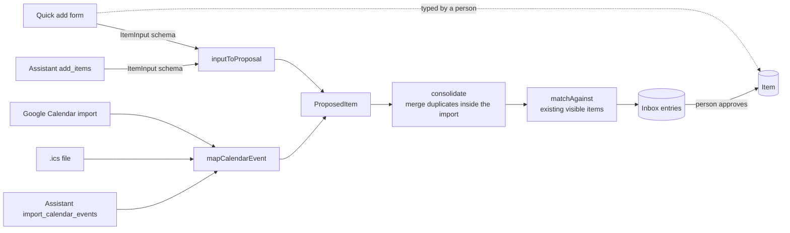
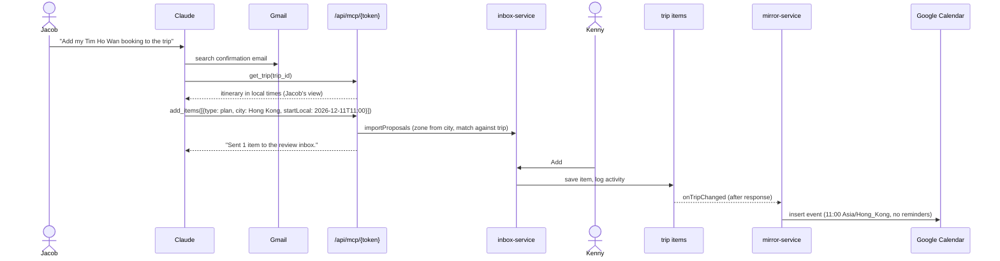
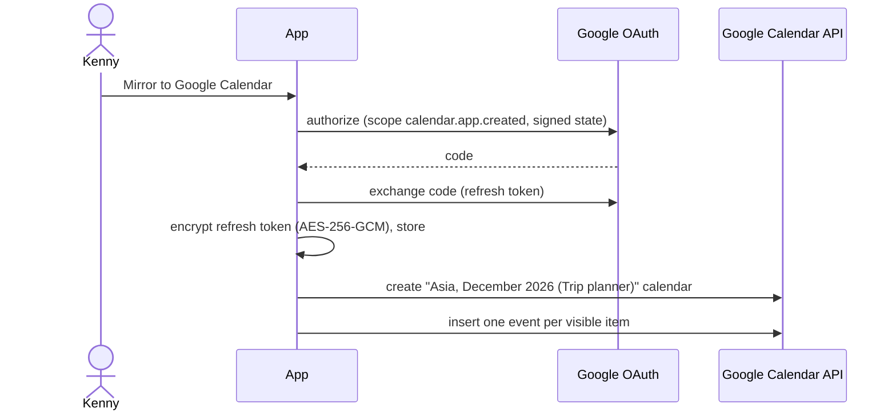
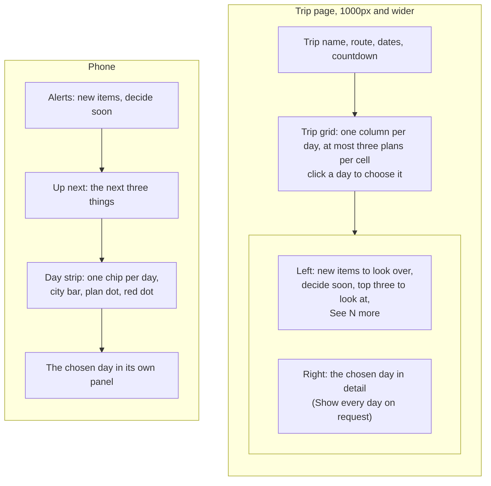
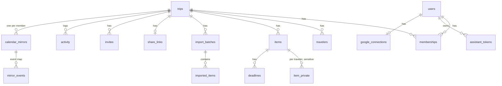
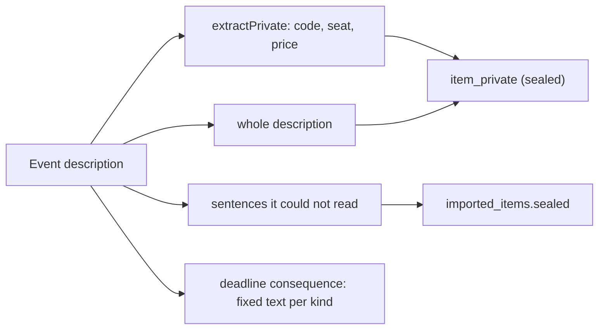

# Architecture

This file explains intent. The code carries no comments (see `docs/ENGINEERING.md`); when you need to know why something is the way it is, it should be here or in a test name.

## Goals this architecture serves

1. **The app is the single source of truth for the trip.** Google Calendar, Gmail and AI assistants feed it or copy it. They never hold the master copy.
2. **Anyone can put details in, nothing goes in unreviewed.** People type into quick add. Calendars, files and AI assistants (Claude, ChatGPT) send proposals to a review inbox. A person approves.
3. **Each person sees only what they may see, everywhere.** One function decides visibility, and every screen, API, feed, calendar mirror and assistant goes through it.
4. **Times are honest.** Every instant is stored in UTC with the zone of the place it happens. Display is always local to that place.
5. **Every rule is testable without a browser, a network or a database server.**

## System context

What changed from how the trip was planned before: Jacob's Claude used to read Gmail and write Google Calendar events directly. Now it writes to the app through MCP. Those proposals wait in the inbox, and Google Calendar becomes a read only copy that the app keeps up to date.

## Layers

Dependency rule: arrows point inward. `src/domain` imports nothing from `src/server` or `src/app`, and does no I/O. Services get everything external (database, clock, id generator, Google client, the change hook) through `ServiceContext`, so tests pass a fresh embedded database, a fixed clock and a fake Google.

| Layer | Tested with | Why it is shaped this way |
|---|---|---|
| Domain | Plain unit tests against the fixture trip | The hard rules (time zones, visibility, matching) must be correct before any UI sits on them |
| Services | Integration tests on in-memory PGlite (real Postgres SQL) | Transactions, constraints and races are real; no database server needed |
| MCP | The official MCP client over an in-memory transport | Proves the assistant experience, not just the functions |
| Routes and pages | Running the app and calling `/api/mcp` over HTTP | Thin glue only |

## The permission boundary

- Roles are always read from the stored membership. The requester never carries a role, so a caller cannot claim one.
- Hidden items are absent from the view, not flagged. Items shown as busy become `BusyBlock`s with a start and an end and nothing else: no id, no title.
- Sensitive fields are absent unless the role is owner or editor. The Google mirror also leaves them out by default, because a Google calendar can be shared beyond the app's control.
- Checks, deadlines, the mirror, assistant reads and import matching all take a `TripView`, so they cannot see more than the person they act for.

## Getting data in: one pipeline, many sources

- A person typing into quick add is trusted and goes straight in. Everything else goes to the inbox.
- The quick add form is `/trips/[id]/add`: the page renders `ItemForm` (client), which posts to the `addItem` server action; `parseItemForm` (domain) turns the fields into `ItemInput`, and `quickAddItem` (service) checks permissions and writes. The form's idempotency key makes a repeated submit return the same item. On blur, the member only `placeHint` action resolves a place through `resolvePlace` and `placeContextFor` so the form can say whose time a field is in.
- Zones come from airports and cities, never from the source's claimed zone. Gmail events often carry the calendar owner's zone; the fixture's CX509 claims New York.
- When a zone cannot be known, the proposal carries a `problem`, is marked needs review, and is never added in bulk.
- Two kinds of disagreement are kept apart:
  - `differences`: records inside one import disagree (CX509 at 8:50am vs 9:00am). A person must pick before adding.
  - `match.differences`: the import disagrees with an item already on the trip. A person must pick per field to merge.
- Per traveler fields (seat, confirmation code) never conflict. They become one private row per traveler, which is the NH159 case.

## State charts

Every state chart is generated from the transition tables in `src/domain/state/*.machine.ts`, and written to [STATECHARTS.md](STATECHARTS.md) by `npm run docs:statecharts`. CI fails when that file is stale. Where a machine is enforced (table below), services get the next state only from `transition`, which throws `InvalidTransition` for an event the state does not allow.

| Machine | Status | Where it is enforced |
|---|---|---|
| `assistant-token` | Enforced | `assistant-service.ts`: revoking works only from Active, a second revoke throws `InvalidTransition` (the Disconnect action treats it as already disconnected), a revoked token never resolves |
| `calendar-mirror` | Enforced | `mirror-service.ts`: the state is derived from the row (`enabled`, `lastError`, `lastSyncedAt`) and every change goes through `transition`. `TornDown` is never read back, because a member who left is stored as `enabled = false`, which reads as Off. `Connecting` is only seen between enabling and the first sync |
| `inbox-entry` | Specification | `inbox-service.ts` claims an entry with one conditional `UPDATE ... WHERE state = 'pending'`, which has the same effect for Pending. Wired to the machine in WP-14 |
| `item-visibility` | Specification | `projectTrip` reads `visibility`, `visibleToUserIds` and `showAsBusy`. Editing them goes through the machine in WP-10 |
| `invite` | Specification | Invites are not built yet (WP-09) |
| `view-link` | Specification | The view link is not built yet (WP-16) |

- Inbox entry: the second of two concurrent decisions finds nothing to claim and fails. "Add all without conflicts" applies Add only to entries with no match, no differences and no problems.
- Item visibility: the chart is the creator's setting, `visibility` (everyone, only me, specific people) plus `showAsBusy`. A hidden item is a Busy block for people who cannot see it when `showAsBusy` is on, and absent for them when it is off. Only the creator can change it, and that includes the owner, who cannot see or edit an item someone else hid from them.
- Google Calendar mirror: sync is a diff. `buildMirrorEvents(view)` gives the events the calendar should hold, and `planMirrorSync` compares them with `mirror_events`, the event map of what was last pushed and its hash. The result is the minimal set of creates, updates and deletes. If someone deletes an event in Google, it is recreated on the next change: Google is a copy, the app is the source.
- The session machine arrives with WP-01.

## Sequences

### Jacob's Claude adds a booking from Gmail

### Connecting Google Calendar

The scope `calendar.app.created` lets the app manage only calendars it created. It cannot read or change anything else in the person's Google Calendar.

## Screens and layout

Phone first, one question per screen. From 1000px wide, the trip page combines three answers side by side.

- `buildTripGrid(view)` in `src/domain/timeline` builds the grid from a `TripView`, so it obeys the same visibility rules as everything else. Hidden items show only as Busy.
- Every column header and block links to that day.
- On a phone the page opens on what is next (PRODUCT.md, Now screen): alerts, then `upNext`, then the day strip (`dayStrip`), then one day. The strip replaces the grid on phones and is about 70px tall. Each chip shows the date, a bar in the color of the city you sleep in, a dot when something is planned and a red dot when something needs a look.
- Every day sits in its own soft panel with a sticky date, so days never run together.
- Each fact appears once on a screen. The grid is the overview, the chosen day is the detail, and the left column lists only what needs a decision soon plus the three most important things to check (`byImportance`). Everything else is one click away on the Deadlines tab.
- The chosen day lives in the URL (`?day=2026-12-05`, or `?day=all` for every day), so it survives a reload and can be shared. Without one, the page opens on today during the trip and on the first day before it (`pickDay`).
- Consecutive free days in the same place merge into one row in the day list ("Mon Dec 7 to Wed Dec 9, Free days").
- Deliberately left out: a row of big-number tiles (DESIGN.md lists those as a pattern to avoid) and visa or entry advice (CHECKS.md says not to generate it).

### How the overview evolved

1. A Gantt-style chart with lanes on real elapsed time. Accurate, but it read like a database.
2. A single journey line on real elapsed time. Friendlier, but labels floated at many heights and short things were slivers.
3. The trip grid, one column per day. People plan trips by day, so the overview now does too.
4. Overview plus one day. Showing the grid, every day in full and every check at once repeated each fact three times. Desktop now shows the grid, one chosen day, and a short list of what needs attention.
5. On phones, the grid became a day strip and the page opens on what is next. A full grid or a full list was too much to take in on a small screen.

## Data model (stored)

## Decisions

| Decision | Why | Revisit when |
|---|---|---|
| AI assistants connect over MCP, and the app makes no LLM calls | Keeps the v1 rule "no AI features" inside the app: the assistant is a client, like a calendar import. People use the Claude or ChatGPT they already have | An AI layer inside the app is planned (PHASES.md, Later) |
| Assistant writes always go to the review inbox | "Imports never overwrite silently". Also protects against an assistant misreading an email | Never, for writes. Reads are fine |
| Assistant auth is a secret link (token in the URL), also accepted as a Bearer header | Claude and ChatGPT custom connectors accept a URL with no auth or with OAuth; a secret URL works in both today. Tokens are hashed, scoped to a trip, read or propose, and revocable | Add OAuth 2.1 to the MCP endpoint so connectors can sign in without a secret link |
| Google mirror is one way, app to Google, one calendar per member | One source of truth. Per member, because visibility differs per member | Two way sync is not planned: edits belong in the app |
| Mirror scope `calendar.app.created` | Least privilege: no access to the person's other calendars | n/a |
| Mirrored events have no reminders and do not include codes or seats by default | v1 has no notifications; a Google calendar can be shared beyond the app's permissions | Per member setting `includeSensitive` exists and is off |
| Places resolve offline first (airports, city-timezones, countries-and-timezones), then optionally by address lookup (OpenStreetMap, cached, `ADDRESS_LOOKUP=openstreetmap`); unclear results are saved as flags on the item and shown as checks | Times must be right without asking for offsets; when unsure, say so rather than guess | Off by default because it sends booking addresses to OpenStreetMap |
| PGlite for dev and tests, Postgres in production | Same SQL and migrations; nobody installs a database to run tests | Never for prod: PGlite is single process |
| Every page renders per request: the root layout awaits `connection()` | A nonce based CSP needs the nonce in every script tag, which a page prerendered at build time (the framework's 404 among them) cannot have | A page needs to be static for speed and can be served without scripts |
| `getDb` caches the opening promise, and forgets it if opening fails | One open per process, but a database outage or missing key at start must not keep every later request failing until a restart | n/a |
| Signed cookie session with a dev sign in | Lets the app run and be tested now | Replace with Auth.js (Google, Apple, email link) per CLAUDE.md before anyone but the builders uses it |

## Open questions (need an answer from the trip owner)

1. **"Where you are" order.** TIME_RULES says most recent arrival beats a covering stay. On Dec 6 to 10 there is no transport to Shenzhen, so that rule would say "Hong Kong" while sleeping in Shenzhen. The code uses whichever is newer, the arrival or the stay's check in. Confirm.
2. **The Gmail "Queen beds" stay.** The fixture says it should merge into the Airbnb, but IMPORT.md's matching rules (similar name or address) do not match it. It is shown as a possible match for a person to merge. Confirm that is the intended behavior.
3. **The $1,183.22 stay also overlaps the second Resol Ueno booking on Dec 13.** The fixture's expected checks do not list that overlap, but it is true, so the app reports it.
4. **Whose seat is it?** When a shared calendar record has a seat but several travelers, the seat goes to the one traveler on that record who has no seat yet. Otherwise it stays unassigned. That is how NH159 resolves to 30K Kenny, 30C Jacob.

## Encryption at rest

`item_private.sealed`, `activity.sealed` and `imported_items.sealed` hold AES-256-GCM envelopes (`k1.iv.tag.body`) keyed by `DATA_ENCRYPTION_KEY`, with the purpose and row id as authenticated data. The key is checked when the database opens, so a missing or all-zero key stops the process at start with the setup message. Rows written by older code are sealed on start by `sealLegacyRows`.

Imported free text is never copied into a plaintext column. A denylist of wordings ("confirmation code is", "Booking ID", hyphenated codes) will always miss one, so the design avoids the question:

- The description becomes the private `notes` field, sealed with the other booking details. Only owners and editors see it ("From the booking" in the day details). `items.notes` stays empty for imports.
- Deadline consequences from imports are the fixed text for the deadline kind, never a sentence from the description.
- Sentences the parser could not read live in the sealed import payload and show only in the inbox.
- Text a person types themselves (quick add notes, assistant `add_items` notes) stays in `items.notes`. The private fields exist for codes; putting one in a shared note is the person's choice.
