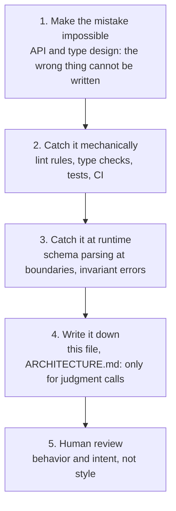

# Engineering principles

How this code base is built and changed, by people and by coding agents alike. Read this before your first change. Most rules are enforced by tooling, so breaking one fails `npm run check` with a message that says what to do instead. This document explains why.

The product rules (time zones, permissions, hidden items, the review inbox) live in `CLAUDE.md` and `docs/`. This file is about how we write and change code. Security and privacy rules live in `docs/SECURITY.md` and take priority over everything here.

## The trust pyramid

Some ways of keeping code right are stronger than others. Always reach for the strongest one that works.

Prose is the weakest layer. If a rule matters and can be checked, it becomes a check. If it keeps coming up in review, it becomes a check.

## The rules

### 1. Fix the root cause

When something is wrong, find out why and fix it there. Do not add a special case, a retry, a timer, a default or a flag that makes the symptom go away. If a change only looks right with an explanation next to it, it is not the fix.

Examples from this repo:
- Two flight events disagreed about airports because the word "Tokyo" matched the airport name "Tokyo Haneda". The fix was that a city name is never an airport name, not a special case for Tokyo.
- Reads inside a transaction used the outer connection and deadlocked. The fix was to pass the transaction through, not to raise the test timeout.
- A placeless stay decided which city a day was in. The fix was that a stay with no known place never decides where you are.

### 2. No comments in code

Code says what it does through names and structure. Why it is that way lives in `docs/ARCHITECTURE.md` (diagrams, state charts, decisions) and in test names. Comments go stale, people skip them, and they cannot stop the next change. Worse, a comment justifying a workaround makes the workaround look intentional to whoever copies it next.

Enforced by `principles/no-comments`. Inline `eslint-disable` comments are turned off too, so a rule cannot be silenced from inside a file.

### 3. Errors are handled or surfaced, never swallowed

Handle a failure where something useful can be done about it: show it to the person, record it, retry with intent. Otherwise let it propagate. No empty catch blocks, no `.catch(() => fallback)`, and no defaults that hide a missing input.

Examples: a failed calendar sync is recorded on the mirror row, shown on the Connect page, and returned to the caller as an outcome. `ServiceContext.onTripChanged` has no default, so every caller decides what happens after a change.

Enforced by `no-empty`, `no-useless-catch`, `@typescript-eslint/no-empty-function` and a rule against arrow functions passed to `.catch`.

### 4. Types tell the truth

Data from outside (HTTP bodies, Google responses, OAuth state, JSON files, datasets, assistant tool input) is parsed with a zod schema where it enters. Inside, types are trusted because they were checked. No `as` casts (`as const` is fine), no non-null `!`, no `any`, no `@ts-ignore`. If the type is wrong, fix it where it is produced. In tests, `present()` from `src/testing` checks for a missing value instead of `!`.

Examples: inbox differences are a union typed per field, so applying a choice needs no cast. Luxon is configured with `throwOnInvalid` in `src/domain/time/luxon.ts`, so its dates are never null.

Enforced by `no-restricted-syntax` (casts, non-null assertions), `@typescript-eslint/no-explicit-any` and `@typescript-eslint/ban-ts-comment`.

### 5. Boundaries are mechanical

The layers in `docs/ARCHITECTURE.md` are enforced by imports, not by good intentions:
- `src/domain` is pure. No I/O, no framework, no imports from `src/server` or `src/app`.
- `src/server` never imports from `src/app`.
- Time math goes through `src/domain/time/luxon.ts`, never `luxon` directly.

Enforced by `no-restricted-imports`, configured per directory.

### 6. Make the wrong thing impossible to write

Prefer an API that cannot be misused over a rule about how to use it.

| Instead of a rule saying | The code makes it impossible |
|---|---|
| "Check the role before showing data" | Every read goes through `projectTrip`, which returns a view that contains only what the requester may see |
| "Don't trust the caller's role" | `Requester` has no role field; roles come from stored memberships |
| "Imports must be reviewed" | Import and assistant paths can only create inbox entries; only approve and merge write items |
| "Don't approve an entry twice" | Deciding an entry is one conditional `UPDATE ... WHERE state = 'pending'` |
| "Never store a bare local time" | `ZonedTime` is an instant plus a zone, and `fromLocal` requires both |

### 7. Every feature can be verified

A feature is not done until there is a test that proves it, written against the December fixture trip wherever the fixture covers it. The acceptance checks in `docs/PHASES.md` are tests, not a checklist.
- Domain rules: unit tests.
- Services: integration tests on in-memory PGlite (real Postgres SQL, real transactions).
- Assistant tools: the official MCP client over an in-memory transport.
- Outside services: fakes behind interfaces (`FakeGoogleCalendar`), never live calls in tests.

Each bug fix starts with a test that fails for the right reason.

### 8. Show it running

Passing checks do not prove the product is right. Before calling UI or integration work done, run the app (`npm run dev`, sign in with the dev sign in) and look at the screens on a phone-sized window. Call `/api/mcp` over HTTP, and attach screenshots or output to the change. Reviewers judge the behavior they can see, not only the diff.

### 9. Behavior has a reviewable model

Anything with states (inbox entries, mirrors, assistant connections, item visibility, invites, view links) is a machine in code: one `src/domain/state/<name>.machine.ts` with a transition table built by `defineMachine`. Services take the next state from `transition`, never by writing a state value directly. The charts in `docs/STATECHARTS.md` are generated from those tables by `npm run docs:statecharts` and CI fails when they drift, so the diagram cannot disagree with the code. User-facing paths are listed in `docs/FEATURES.md`. Update the machine, the regenerated chart and `docs/FEATURES.md` in the same change that alters behavior, so a reviewer can compare what was intended with what was built.

### 10. Turn repeated feedback into a check

When the same correction comes up twice, in review or in an agent's output:
1. Add a lint rule, type or test that catches it, with a message that tells the author what to do instead.
2. Remove the existing examples, so nobody copies them.
3. Give the author a way to verify the right behavior: a test helper, a fixture case, a script.

Do not just repeat the correction, and do not only write it down here.

### 11. The code base is the prompt

People and agents copy what they see. Delete dead code, deprecated paths, scaffolding and workarounds as soon as they stop being needed. Never leave a pattern in the repo that you would not want repeated a hundred times.

### 12. Built to last

- Small modules with one job, and explicit dependencies: services receive a `ServiceContext` instead of reaching for globals.
- Schema changes go through checked-in migrations (`npm run db:generate`).
- No hidden defaults for things that matter.
- Prefer boring, well-maintained dependencies, with exact reasons to add one.
- Leave every file you touch passing every check.

## How the rules are enforced

| Rule | Mechanism | Where |
|---|---|---|
| 2. No comments | `principles/no-comments`, inline config disabled | `eslint.config.mjs` |
| 3. No swallowed errors | `no-empty`, `no-useless-catch`, `no-empty-function`, `.catch(() => ...)` ban | `eslint.config.mjs` |
| 4. Types tell the truth | cast and `!` bans, `no-explicit-any`, `ban-ts-comment`, TypeScript strict | `eslint.config.mjs`, `tsconfig.json` |
| 5. Boundaries | `no-restricted-imports` per directory | `eslint.config.mjs` |
| 6. Wrong thing impossible | Types and APIs in `src/domain` and `src/server/services` | code |
| 7. Verified | 100+ tests, `npm run check` | CI on every push and pull request |
| 9. Behavior has a model | State machines in `src/domain/state`, generated `docs/STATECHARTS.md`, `statecharts` CI job | `npm run docs:statecharts:check` |
| 1, 8, 10 to 12 | Pull request checklist and review | `.github/pull_request_template.md` |

## Definition of done

- [ ] `npm run check` passes (types, lint, tests).
- [ ] New behavior has tests; a bug fix has a test that failed before the fix.
- [ ] The root cause was fixed, not the symptom.
- [ ] UI or integration changes were run and looked at; the evidence is in the pull request.
- [ ] `docs/ARCHITECTURE.md` and `docs/FEATURES.md` match the new behavior.
- [ ] Nothing dead or deprecated was left behind.

## Credit

Rules 6, 8, 9, 10, 11 and the trust pyramid adopt ideas from Lauren Tan's talk *All Code Is Slop (Except Mine)* at AI Engineer (https://ai.engineer/talks/O_zcc6Xl12g-all-code-is-slop-except-mine): encode decisions as APIs and checks rather than prose, ban comments and put guidance in lint diagnostics, enforce boundaries mechanically, turn repeated review corrections into checks, treat the code base as the input every agent learns from, and have agents show the running product with reviewable models of behavior.
