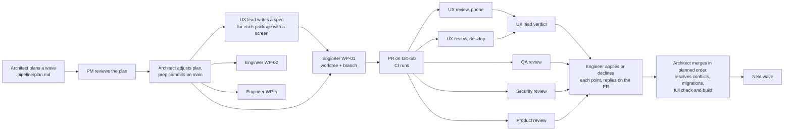
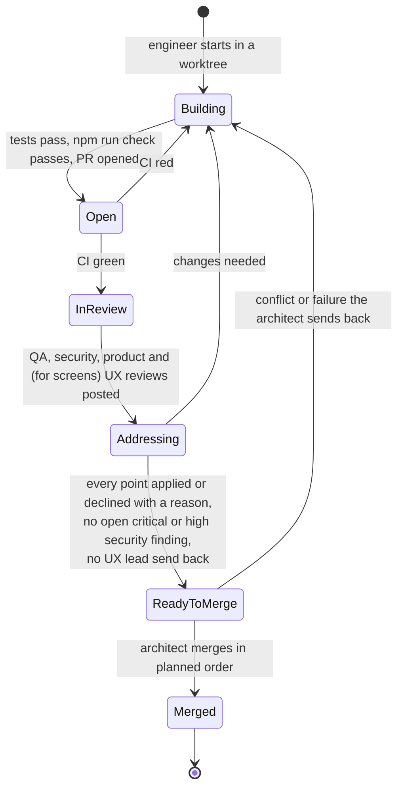

# Delivery pipeline

How work gets built here: one architect plans and integrates, a UX lead specifies every screen before it is built, engineers build in parallel, and reviewers scrutinize every pull request before it merges: QA, security and product on every PR, plus two UX reviewers (phone and desktop) and the UX lead's verdict on every PR that adds or changes a screen. The roles are defined in `.claude/agents/`.

| Role | Model | Does | Never does |
|---|---|---|---|
| Architect, dev lead (`architect`) | Opus | Plans work packages, sorts dependencies, owns shared files, merges, resolves conflicts, final QA on main | Merges with a failing check, an open critical or high security finding, or a UX lead send back |
| Engineer (`engineer`) | Sonnet | Builds one work package test first in its own worktree, opens the PR, decides on each review point | Commits to main, adds dependencies, edits files another package owns |
| QA reviewer (`qa-reviewer`) | Sonnet | Proves defects with tests or by running the app, checks the acceptance tests | Edits the code |
| Security reviewer (`security-reviewer`) | Sonnet | Reviews access control, data exposure, tokens, input handling, outbound calls, logging | Edits the code, pastes personal data into comments |
| Product manager (`product-manager`) | Sonnet | Reviews the plan and every user facing PR as a user on a phone | Edits the code |
| UX lead (`ux-lead`) | Opus | Owns docs/UX.md, writes a design spec in `.pipeline/specs/WP-NN.md` before any screen is built, gives the final UX verdict on every user facing PR | Edits application code; a "send back" blocks the merge until the lead signs off |
| UX reviewer (`ux-reviewer`) | Sonnet | Reviews one user facing PR on one device class (phone or desktop) against docs/UX.md, docs/DESIGN.md and the spec, with screenshots and axe | Edits the code, resizes anyone's browser window |

## Flow



## A pull request's life



### Draft pull requests and CI

- An engineer keeps the pull request a draft only while still building. CI does not run on a draft (gitleaks does), so work in progress pushes cost nothing.
- The engineer marks it ready for review at the moment it asks for reviews, so CI runs alongside the reviews and the reviewers have results before they finish. Reviewers never review without CI.
- Each review-fix push reruns CI, and the concurrency group cancels the superseded run. Do not re-run a workflow run created while the pull request was a draft: it keeps the draft state and stays skipped. Push a commit or mark the pull request ready instead.
- Pull requests that change only Markdown files or `.pipeline/` skip the heavy jobs: a small `changes` job decides, and the jobs it skips report "skipped", which counts as passing for required checks (a workflow level path filter would leave them pending forever). Performance (`measure`) runs on pushes to main, nightly, and on pull requests only when they change `src/app`, `src/server`, `src/components`, `perf/`, `next.config.*`, the package files or the perf workflow and its config, or carry the `perf` label.
- CI on a pull request is five jobs: `static` (lint, typecheck, statecharts, audit, migrations), `test`, `postgres`, `prod-build` (one production build used for the end to end tests and the production guard checks) and `gitleaks`.

### Merging under the branch ruleset

Main has a ruleset with no bypass: every change goes through a pull request (no approvals needed), no force push or branch deletion, the required checks are `test`, `postgres` and `gitleaks`, and the branch must be up to date with main before it merges. So every merge goes like this, one merge at a time:

1. Update the branch with main: `gh api -X PUT repos/kenneth-yu/trip-planner/pulls/<n>/update-branch`.
2. Wait for the required checks on the new head.
3. Merge: `gh pr merge <n> --merge --delete-branch --match-head-commit <sha>`.

A job that its `if` skips (a draft, or a documentation-only change) reports "skipped", which counts as passing for a required check.

### The merge gate

Agents never merge by hand. They post verdicts and push; the `merge-gate` workflow does the rest. It runs when a ci, perf or security run finishes, on comments, when a pull request is opened, marked ready, pushed or relabelled, every 15 minutes, and on demand, one run at a time (`merge-gate` concurrency group, nothing cancelled). Each run goes through the open, non-draft pull requests from this repository and merges at most one.

A pull request merges when all of this holds (the logic is `tools/merge-gate-lib.mjs`, tested in `src/tools/merge-gate.test.ts`; the reviewer mapping is data in `tools/merge-gate-config.json`):

- The checks `static`, `test`, `postgres`, `prod-build` and `gitleaks` are green on the head. A check that was skipped counts as passing.
- Every reviewer the changed paths call for has a fresh, positive verdict. QA on every code pull request; Security when it touches `src/server/**`, `src/proxy.ts`, `src/instrumentation.ts`, `src/app/api/**`, `src/app/**/actions.ts`, `drizzle/**`, the package files or the migrate and seed scripts; Product for `src/app/**`, services, MCP and domain; the UX lead for tsx, CSS, public files and the manifest; the Architect on the integration owned list. Test files do not call for Security, Product or UX. Documentation only pull requests need no review.
- Verdicts come only from the repository owner's account (every agent posts as it), under the standard heading, with the first body line `Verdict: <word> at <sha>`: approve, approve with changes or send back for QA, Product, UX lead and Architect; clear, clear with fixes or blocked for Security. The sha is the commit reviewed. "With changes" and "with fixes" count once a reply naming the reviewer (`QA: Applied 1 and 2, Declined 3.`) follows the last code push. A verdict on an earlier commit is stale unless only verified merges of main follow it.
- A pull request that changes the app has exactly one `Semver: major`, `Semver: minor` or `Semver: patch` line in its body (breaking is major, a feature is minor, a fix is patch).
- No `hold` or `do-not-merge` label. A pull request that touches `.claude/`, `CLAUDE.md` or `.github/workflows/` is labelled `needs-owner` and never merges through the gate (the `GATE_TOKEN` is created without the Workflows permission, so GitHub would refuse the push or merge anyway; if its refusal names the workflow scope, the gate treats it the same way and does not retry). The `needs-owner` label also stops the gate until the owner removes it or merges the pull request.
- The gate read everything it needs. If a file list, comment list, check list or compare result is missing or truncated, it merges nothing and says so in its one comment.

When a pull request passes but its branch is behind main, the gate updates the branch, the checks run again as for any push, and it merges on a later run. When it passes and is up to date, the gate merges with the head sha pinned. Updating and merging use the `GATE_TOKEN` repository secret (a fine grained token for this repository), so the pushes count as the owner's and trigger the normal workflows; everything else in the gate uses the workflow token. If the secret is missing the gate does nothing to the branch and says so in its comment; it never falls back to the workflow token. When it does not pass, the gate leaves one comment, edited in place, listing what is missing.

At merge time the gate writes the validated level into the merge commit as a `Semver:` line and the push to main starts the `release` workflow for that commit. `release` reads that line only (never the pull request body, and not inside a code fence), releases only when the merge changed an app path, tags the next version from the latest tag at run time (it works the tag out again once if the tag already exists, and fails loudly after that) and creates a GitHub release titled with the pull request's title. It never commits to main. `deploy-prod` first sets a `deploy/approved` commit status on main's head, so the Vercel ignore script can tell an owner-requested production build from a merge. Production deploys only when the owner asks: the `deploy-prod` workflow (run by hand from main, with the confirmation text, in the `production` environment so a required reviewer can be added) calls the Vercel deploy hook.

### Working rules

1. Report only a change of state: a pull request opened, pushed, blocked, a verdict posted, or merged. Do not send "still waiting" or "nothing changed" reports, and do not relay another agent's report. Engineers put the details in a pull request comment and send the coordinator one line. Escalate only what needs a decision.
2. Hot files: two packages in flight never share a hot file, such as `day-view.tsx`, `nav.tsx`, `rate-limit.ts` or `actions.ts`. If they have to, split the file first in a small refactor pull request. Every spec carries a "files touched" line, and the architect checks the overlap (`git diff --stat` per branch, or against the spec's list) before starting a package.
3. Copy: the UX lead owns all user facing copy. Product reviews behaviour and scope only, never wording. If product thinks a line of copy is wrong, it tells the UX lead and does not propose replacement text.

## How conflicts are avoided

- Each wave's packages own disjoint files. Shared hot files (database schema, migrations, domain types, navigation, package files, feature map, architecture doc) have one owner per wave or change only in an architect prep commit on main.
- Dependencies are installed by the architect on main before a wave starts.
- Migrations are generated by the architect at merge time, in merge order.
- Where two packages meet, the architect writes the contract (function signatures) into the plan or lands it on main first.

## State machines and generated charts

State machines are code: each lives in `src/domain/state/<name>.machine.ts` with exactly one `export const machine = defineMachine(...)`, and services take the next state from `transition`. `docs/STATECHARTS.md` is generated by `npm run docs:statecharts` and checked by `npm run docs:statecharts:check` in CI. Adding a machine touches no shared registry, because the generator finds machines by glob. On a merge conflict in `docs/STATECHARTS.md`, rerun the generator instead of merging by hand.

## Self-healing

Every agent follows the protocol in the plan. On a failure (test, lint, type, build, CI job, migration, conflict), read the real error, state a hypothesis, reproduce, fix the root cause and rerun the full check, with up to three attempts per distinct problem, each logged in the incidents table of `.pipeline/status.md`. Never heal by weakening: no skipped or deleted tests, lowered floors or budgets, disabled lint rules, casts or hiding retries. After three failed attempts write a blocker file, mark the package blocked and move on. A refused action is a blocker for the user, not something to work around. Every run ends by updating the status file.

## Working files

`.pipeline/` in the main checkout is gitignored: the plan, PR pointers, review copies, scratch tests and the status log. Reviews themselves live on the GitHub pull requests.

## Checking phone layouts

Never resize anyone's browser window. Serve the phone frame and open it in a tab:

```bash
python3 -m http.server 8766 --directory tools/phone-frame --bind 127.0.0.1
```

Then open `http://localhost:8766/?url=http://localhost:3000/trips/<trip id>`. The frame is 390 by 844 and the app inside it uses its phone layout. Use `localhost` (not `127.0.0.1`) for both, so the sign in cookie is sent.

## Running an app from a worktree

Use the review server. It picks a free port, seeds the demo trips into a scratch database, and prints the URL:

```bash
node tools/review-server.mjs
node tools/review-server.mjs --dev
```

- Default: `next build` then `next start` with `REVIEW_SERVER=1` and `DEV_SIGN_IN=1` (a flag the app honours only when no Vercel variable and no `DATABASE_URL` is present), so you see the production build signed in (`/api/dev/sign-in?as=kenny`) on a scratch embedded database seeded with the demo trips.
- `--dev` runs `next dev` instead. Use it only when asked: it is the heavy mode.
- It listens on 127.0.0.1 only and passes the child process an allowlisted environment (no email, Google or database variables).
- It refuses to start when `DATABASE_URL` is set in your shell or when the folder has an env file (`.env`, `.env.local` and the like), so it can never touch a real database or read real secrets. It never reads those files.
- It stops itself after 45 minutes. The server runs under `timeout`, so it is killed on schedule even if the wrapper is killed. Stop it before you finish (Ctrl-C).
- At most 2 review servers run at once across all worktrees. The lock lives in `trip-planner-review-servers` under the system temp directory, stale entries are removed, and a third start prints which pids and ports hold the slots.
- Secrets are generated per run and never printed. The scratch database is deleted on exit. Never point it at a real database.
