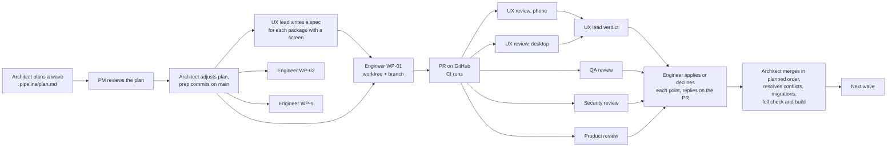
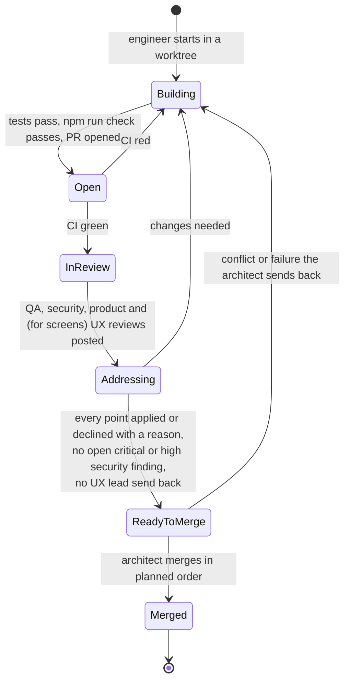

# Delivery pipeline

How work gets built here: one architect plans and integrates, a UX lead specifies every screen before it is built, engineers build in parallel, and reviewers scrutinize every pull request before it merges: QA, security and product on every PR, plus two UX reviewers (phone and desktop) and the UX lead's verdict on every PR that adds or changes a screen. The roles are defined in `.claude/agents/`.

| Role | Model | Does | Never does |
|---|---|---|---|
| Architect, dev lead (`architect`) | Opus | Plans work packages, sorts dependencies, owns shared files, merges, resolves conflicts, final QA on main | Merges with a failing check, an open critical or high security finding, or a UX lead send back |
| Engineer (`engineer`) | Sonnet | Builds one work package test first in its own worktree, opens the PR, decides on each review point | Commits to main, adds dependencies, edits files another package owns |
| QA reviewer (`qa-reviewer`) | Sonnet | Proves defects with tests or by running the app, checks the acceptance tests | Edits the code |
| Security reviewer (`security-reviewer`) | Sonnet | Reviews access control, data exposure, tokens, input handling, outbound calls, logging | Edits the code, pastes personal data into comments |
| Product manager (`product-manager`) | Sonnet | Reviews the plan and every user facing PR as a user on a phone | Edits the code |
| UX lead (`ux-lead`) | Opus | Owns docs/UX.md, writes a design spec in `.pipeline/specs/WP-NN.md` before any screen is built, gives the final UX verdict on every user facing PR | Edits application code; a "send back" blocks the merge until the lead signs off |
| UX reviewer (`ux-reviewer`) | Sonnet | Reviews one user facing PR on one device class (phone or desktop) against docs/UX.md, docs/DESIGN.md and the spec, with screenshots and axe | Edits the code, resizes anyone's browser window |

## Flow



## A pull request's life



### Draft pull requests and CI

- An engineer keeps the pull request a draft only while still building. CI does not run on a draft (gitleaks does), so work in progress pushes cost nothing.
- The engineer marks it ready for review at the moment it asks for reviews, so CI runs alongside the reviews and the reviewers have results before they finish. Reviewers never review without CI.
- Each review-fix push reruns CI, and the concurrency group cancels the superseded run.
- Pull requests that change only Markdown files or `.pipeline/` skip CI (their required checks do not report, so the merge gate needs a docs-only exception). Performance (`measure`) runs on pushes to main, nightly, and on pull requests only when they change `src/app`, `src/server`, `src/components`, `perf/`, `next.config.*`, the package files or the perf workflow and its config, or carry the `perf` label.
- CI on a pull request is five jobs: `static` (lint, typecheck, statecharts, audit, migrations), `test`, `postgres`, `prod-build` (one production build used for the end to end tests and the production guard checks) and `gitleaks`.

## How conflicts are avoided

- Each wave's packages own disjoint files. Shared hot files (database schema, migrations, domain types, navigation, package files, feature map, architecture doc) have one owner per wave or change only in an architect prep commit on main.
- Dependencies are installed by the architect on main before a wave starts.
- Migrations are generated by the architect at merge time, in merge order.
- Where two packages meet, the architect writes the contract (function signatures) into the plan or lands it on main first.

## State machines and generated charts

State machines are code: each lives in `src/domain/state/<name>.machine.ts` with exactly one `export const machine = defineMachine(...)`, and services take the next state from `transition`. `docs/STATECHARTS.md` is generated by `npm run docs:statecharts` and checked by `npm run docs:statecharts:check` in CI. Adding a machine touches no shared registry, because the generator finds machines by glob. On a merge conflict in `docs/STATECHARTS.md`, rerun the generator instead of merging by hand.

## Self-healing

Every agent follows the protocol in the plan. On a failure (test, lint, type, build, CI job, migration, conflict), read the real error, state a hypothesis, reproduce, fix the root cause and rerun the full check, with up to three attempts per distinct problem, each logged in the incidents table of `.pipeline/status.md`. Never heal by weakening: no skipped or deleted tests, lowered floors or budgets, disabled lint rules, casts or hiding retries. After three failed attempts write a blocker file, mark the package blocked and move on. A refused action is a blocker for the user, not something to work around. Every run ends by updating the status file.

## Working files

`.pipeline/` in the main checkout is gitignored: the plan, PR pointers, review copies, scratch tests and the status log. Reviews themselves live on the GitHub pull requests.

## Checking phone layouts

Never resize anyone's browser window. Serve the phone frame and open it in a tab:

```bash
python3 -m http.server 8766 --directory tools/phone-frame --bind 127.0.0.1
```

Then open `http://localhost:8766/?url=http://localhost:3000/trips/<trip id>`. The frame is 390 by 844 and the app inside it uses its phone layout. Use `localhost` (not `127.0.0.1`) for both, so the sign in cookie is sent.

## Running an app from a worktree

Use the review server. It picks a free port, seeds the demo trips into a scratch database, and prints the URL:

```bash
node tools/review-server.mjs
node tools/review-server.mjs --dev
```

- Default: `next build` then `next start` with `REVIEW_SERVER=1` and `DEV_SIGN_IN=1` (a flag the app honours only when no Vercel variable and no `DATABASE_URL` is present), so you see the production build signed in (`/api/dev/sign-in?as=kenny`) on a scratch embedded database seeded with the demo trips.
- `--dev` runs `next dev` instead. Use it only when asked: it is the heavy mode.
- It listens on 127.0.0.1 only and passes the child process an allowlisted environment (no email, Google or database variables).
- It refuses to start when `DATABASE_URL` is set in your shell or when the folder has an env file (`.env`, `.env.local` and the like), so it can never touch a real database or read real secrets. It never reads those files.
- It stops itself after 45 minutes. The server runs under `timeout`, so it is killed on schedule even if the wrapper is killed. Stop it before you finish (Ctrl-C).
- At most 2 review servers run at once across all worktrees. The lock lives in `trip-planner-review-servers` under the system temp directory, stale entries are removed, and a third start prints which pids and ports hold the slots.
- Secrets are generated per run and never printed. The scratch database is deleted on exit. Never point it at a real database.
