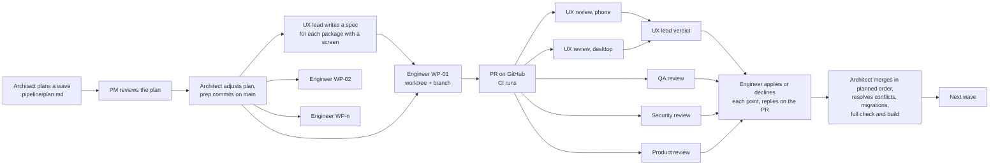
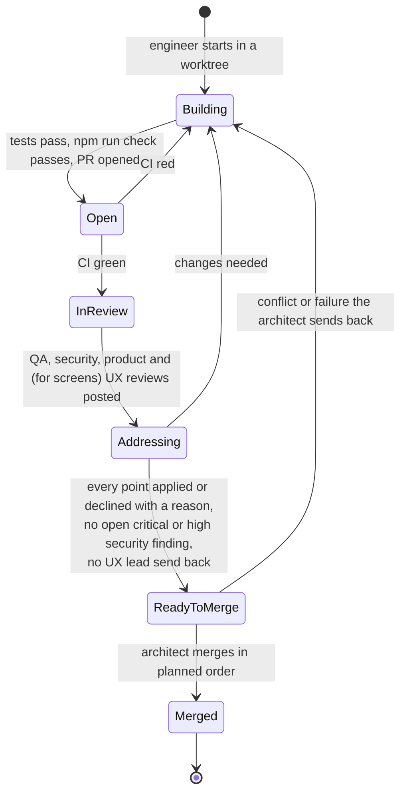

# Delivery pipeline

How work gets built here: one architect plans and integrates, a UX lead specifies every screen before it is built, engineers build in parallel, and reviewers scrutinize every pull request before it merges: QA, security and product on every PR, plus two UX reviewers (phone and desktop) and the UX lead's verdict on every PR that adds or changes a screen. The roles are defined in `.claude/agents/`.

| Role | Model | Does | Never does |
|---|---|---|---|
| Architect, dev lead (`architect`) | Opus | Plans work packages, sorts dependencies, owns shared files, merges, resolves conflicts, final QA on main | Merges with a failing check, an open critical or high security finding, or a UX lead send back |
| Engineer (`engineer`) | Sonnet | Builds one work package test first in its own worktree, opens the PR, decides on each review point | Commits to main, adds dependencies, edits files another package owns |
| QA reviewer (`qa-reviewer`) | Sonnet | Proves defects with tests or by running the app, checks the acceptance tests | Edits the code |
| Security reviewer (`security-reviewer`) | Sonnet | Reviews access control, data exposure, tokens, input handling, outbound calls, logging | Edits the code, pastes personal data into comments |
| Product manager (`product-manager`) | Sonnet | Reviews the plan and every user facing PR as a user on a phone | Edits the code |
| UX lead (`ux-lead`) | Opus | Owns docs/UX.md, writes a design spec in `.pipeline/specs/WP-NN.md` before any screen is built, gives the final UX verdict on every user facing PR | Edits application code; a "send back" blocks the merge until the lead signs off |
| UX reviewer (`ux-reviewer`) | Sonnet | Reviews one user facing PR on one device class (phone or desktop) against docs/UX.md, docs/DESIGN.md and the spec, with screenshots and axe | Edits the code, resizes anyone's browser window |

## Flow



## Flow rules

The owner's rules for keeping work moving:

- No engineer sits idle. When one finishes, the architect hands over the next ready package straight away.
- An engineer has at most 2 open PRs. Send-backs on an open PR come before starting new work.
- All reviews start when a PR is open and CI is green. The UX lead's verdict comes after both UX passes (phone and desktop).
- A small re-review (3 points or fewer) is done from the diff within one turn, not as a fresh full review.
- Specs run one wave ahead: the UX lead writes a spec for a package before its engineer starts.
- Merge each PR when it is ready. Open PRs then merge main into their branch.
- At most 6 engineers work at once.

## A pull request's life



## Architect checklist before a merge

- [ ] CI is green, including the accessibility gate in the e2e job.
- [ ] No open critical or high security finding and no UX lead send back.
- [ ] A reviewer finding repeated twice must come with a new check (lint rule, test, type or CI job) that catches it, with a message that says what to do instead, and the existing examples removed. Prose in docs/ENGINEERING.md alone does not close it.
- [ ] Any prose rule that a check now enforces is deleted from the docs and replaced by a pointer to the check.

## How conflicts are avoided

- Each wave's packages own disjoint files. Shared hot files (database schema, migrations, domain types, navigation, package files, feature map, architecture doc) have one owner per wave or change only in an architect prep commit on main.
- Dependencies are installed by the architect on main before a wave starts.
- Migrations are generated by the architect at merge time, in merge order.
- Where two packages meet, the architect writes the contract (function signatures) into the plan or lands it on main first.

## State machines and generated charts

State machines are code: each lives in `src/domain/state/<name>.machine.ts` with exactly one `export const machine = defineMachine(...)`, and services take the next state from `transition`. `docs/STATECHARTS.md` is generated by `npm run docs:statecharts` and checked by `npm run docs:statecharts:check` in CI. Adding a machine touches no shared registry, because the generator finds machines by glob. On a merge conflict in `docs/STATECHARTS.md`, rerun the generator instead of merging by hand.

## Self-healing

Every agent follows the protocol in the plan. On a failure (test, lint, type, build, CI job, migration, conflict), read the real error, state a hypothesis, reproduce, fix the root cause and rerun the full check, with up to three attempts per distinct problem, each logged in the incidents table of `.pipeline/status.md`. Never heal by weakening: no skipped or deleted tests, lowered floors or budgets, disabled lint rules, casts or hiding retries. After three failed attempts write a blocker file, mark the package blocked and move on. A refused action is a blocker for the user, not something to work around. Every run ends by updating the status file.

## Working files

`.pipeline/` in the main checkout is gitignored: the plan, PR pointers, review copies, scratch tests and the status log. Reviews themselves live on the GitHub pull requests.

## Checking phone layouts

Never resize anyone's browser window. Serve the phone frame and open it in a tab:

```bash
python3 -m http.server 8766 --directory tools/phone-frame --bind 127.0.0.1
```

Then open `http://localhost:8766/?url=http://localhost:3000/trips/<trip id>`. The frame is 390 by 844 and the app inside it uses its phone layout. Use `localhost` (not `127.0.0.1`) for both, so the sign in cookie is sent.

## Running an app from a worktree

Each reviewer runs their own copy so nobody touches the main dev database:

```bash
PGLITE_DIR=<main>/.pipeline/scratch/WP-NN/db DATA_ENCRYPTION_KEY=<base64 32 bytes> npm run db:seed
PGLITE_DIR=<main>/.pipeline/scratch/WP-NN/db DEV_SIGN_IN=1 SESSION_SECRET=<32+ chars> TOKEN_ENCRYPTION_KEY=<base64 32 bytes> DATA_ENCRYPTION_KEY=<base64 32 bytes> npx next dev --port 31NN
```
