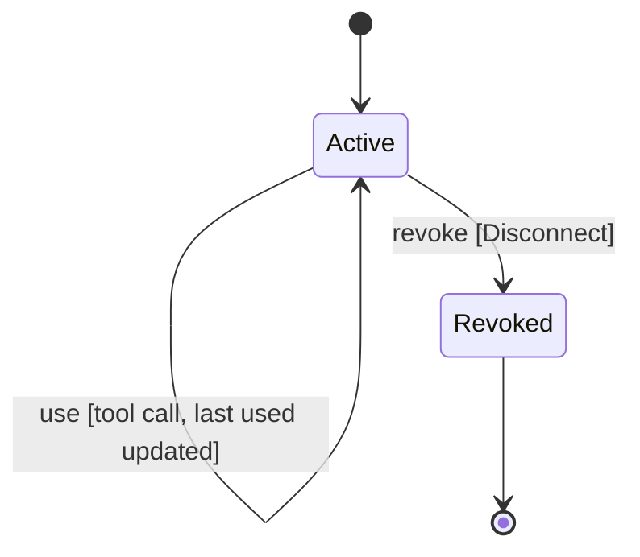
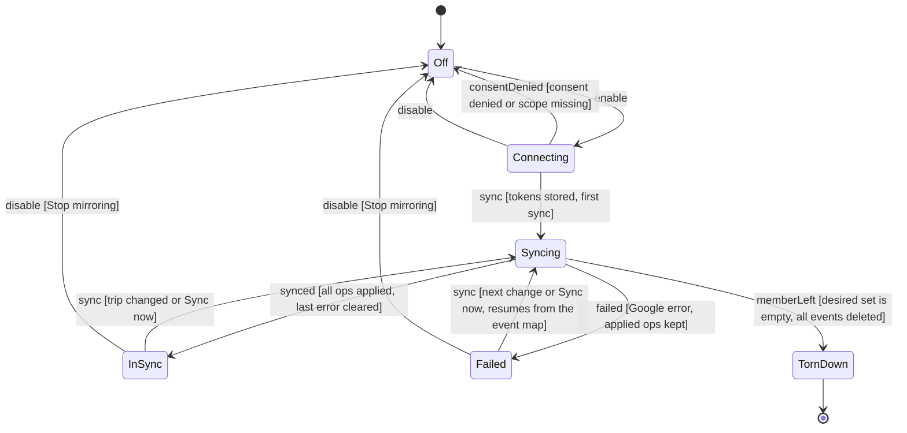
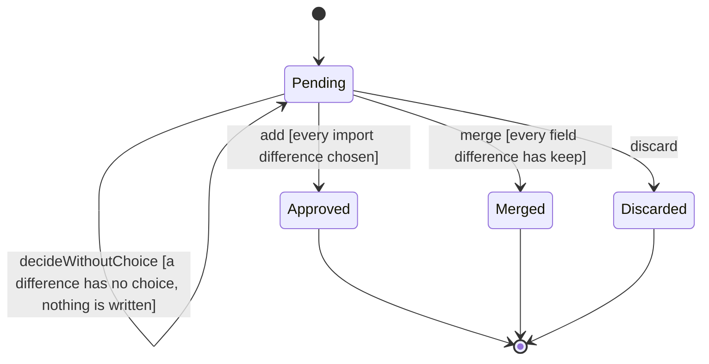
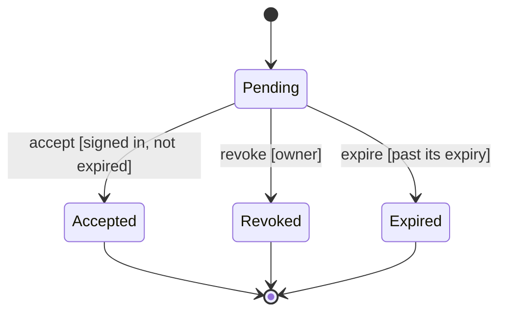
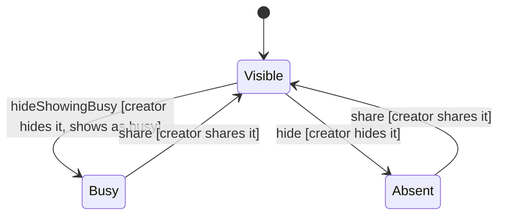
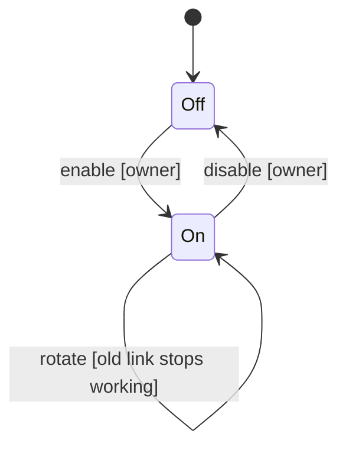

# State charts

Generated by `npm run docs:statecharts` from the transition tables in `src/domain/state/*.machine.ts`. Do not edit by hand. CI fails when this file is stale.

## Assistant connection

Machine: `assistant-token`

## Google Calendar mirror (per member, per trip)

Machine: `calendar-mirror`

## Inbox entry

Machine: `inbox-entry`

## Invite

Machine: `invite`

## Item as seen by one member

Machine: `item-visibility`

## View link

Machine: `view-link`

